# LUMA E-Commerce Platform — System Architecture & Engineering Blueprint

> **Enterprise Frontend Architecture**  
> **Project:** LUMA — The Science of Light. The Power to Heal  
> **Organization:** Norvexa Technologies  
> **Repository:** `NorvexaTechnologies/luma-frontend`  
> **Version:** 1.0.0 (Production Master)  

---

## 1. Executive Summary & Vision

**LUMA** is an ultra-premium, medical-grade photobiomodulation (red and near-infrared light therapy) e-commerce platform. Built with **React 19**, **Vite 8**, and **Tailwind CSS v4**, the frontend provides an uncompromising digital experience calibrated to millimeter precision against a master 3840px PSD design canvas.

### Core Architectural Goals:
1. **Mathematical Display Fidelity:** Exact coordinate, font weight, and spatial alignment across 6 distinct monitor viewports ranging from 375px mobile screens to 3840px 4K UHD workstations.
2. **Zero-CDN Local Asset Independence:** 100% self-hosted typography and media pipeline, eliminating external runtime blocking requests (e.g. Google Fonts CDN) to guarantee deterministic rendering and instant Core Web Vitals.
3. **High-Performance Micro-Interactivity:** Fluid slide-over shopping drawers, real-time localized currency switching, interactive diagnostic assessment quiz, before-and-after interactive slider, and unboxed radial glow lighting effects.
4. **Autonomous Ralph Loop Alignment:** Continuous validation via automated Playwright visual testing matrices (`scripts/`), strictly tracking 17 acceptance criteria in `prd.json` to 100% completion.

---

## 2. Technology Stack & Decision Matrix

| Layer | Technology | Version | Rationale |
|---|---|---|---|
| **Core Framework** | React | `^19.3.0` | Concurrent rendering, modern hooks, optimal DOM reconciliation. |
| **Build Engine** | Vite | `^8.3.3` | Instant HMR development server, Rollup-powered production treeshaking. |
| **CSS Architecture** | Tailwind CSS + `@tailwindcss/vite` | `^4.3.3` | Next-generation engine with native `@theme` CSS custom properties and custom breakpoint hierarchy. |
| **Typography Engine** | Local TrueType Font (TTF) Matrix | Manrope 200–800 | 7 discrete local font weights to prevent layout shifts and eliminate external CDN latency. |
| **Display Engine** | Dedicated Screen Breakpoint Rules | Custom CSS | Pure media-query based geometric scaling for FHD, 2K, and 4K displays (`src/styles/screens.css`). |
| **Automated QA** | Playwright + Python Visual Regression | Custom Scripts | Pixel-perfect canvas correlation between Figma/PSD layers and rendered DOM. |
| **Deployment** | Vercel Edge Network | Production | Global edge delivery with `.vercelignore` asset optimization. |

---

## 3. High-Level Component Architecture

The LUMA application uses a centralized component composition pattern in `src/App.jsx`. Modals and drawers are hoisted above the main layout hierarchy to ensure zero z-index collisions and seamless background backdrop locking.

```mermaid
graph TD
    App["App.jsx (Root Container & State Host)"]
    
    subgraph GlobalOverlays["Global Slide-Over Portals"]
        CartDrawer["CartDrawer.jsx (Shopping Bag)"]
        MobileDrawer["MobileDrawer.jsx (Mobile Navigation)"]
    end
    
    subgraph NavigationLayer["Header & Navigation Shell"]
        TopBanner["TopBanner.jsx (Announcement & Localization)"]
        Navbar["Navbar.jsx (Brand & Navigation Matrix)"]
        CurrencyDropdown["CurrencyDropdown.jsx (FX Selector)"]
        TopBanner --> CurrencyDropdown
        Navbar --> CurrencyDropdown
    end
    
    subgraph VisualNarrative["Core Section Hierarchy"]
        Hero["Hero.jsx (Layer 1-3: Backdrop & Core CTA)"]
        TrustStrip["TrustStrip.jsx (Layer 6: Continuous Certifications)"]
        AboutSection["AboutSection.jsx (Layer 7: Dubai 2023 Heritage)"]
        ClinicalTech["ClinicalTech.jsx (Layer 8: Wavelength Penetration)"]
        BenefitsOverview["BenefitsOverview.jsx (Layer 9: 6 Evidence Pillars)"]
        ProductRange["ProductRange.jsx (Layer 10: Hardware Showcase)"]
        AssessmentQuiz["AssessmentQuiz.jsx (Layer 12: Diagnostic Engine)"]
        BeforeAfter["BeforeAfter.jsx (Layer 13: Clinical Results)"]
        FaqSection["FaqSection.jsx (Layer 15: Accordion Knowledge Base)"]
        CommunitySection["CommunitySection.jsx (Layer 16: Brand Community)"]
        ExpertTestimonials["ExpertTestimonials.jsx (Layer 17: Video Cards)"]
        TrustGuarantees["TrustGuarantees.jsx (Layer 18: Warranty & Shipping)"]
        Footer["Footer.jsx (Layer 19+: Global Navigation & Legal)"]
    end

    App --> GlobalOverlays
    App --> NavigationLayer
    App --> VisualNarrative
    
    Navbar -.->|Trigger Open| CartDrawer
    Navbar -.->|Trigger Open| MobileDrawer
    ProductRange -.->|Trigger Add| CartDrawer
    Footer -.->|Trigger Open| CartDrawer
```



---

## 4. Design System & Token Geometry

### 4.1 Color Tokens
The color architecture relies on a dark-lux aesthetic with focused clinical red highlights:

- **Primary Brand Red:** `#EC2024` (High-visibility action buttons, active indicator pills, circular duration badge outlines, active wavelength nm tags)
- **Primary Brand Red Hover:** `#ff3337` (Interactive hover state)
- **Dark Canvas Background:** `#0a0a0a` (Deep obsidian background)
- **Surface Elevation Dark:** `#131313` / `#161616` (Card backdrops and interactive options)
- **High Contrast White:** `#FFFFFF` (Section canvas for Benefits, Products, FAQs, and Experts)
- **Neutral Surface Light:** `#F3F3F3` / `#F1F0F0` (Unboxed product preview frames and FAQ pill buttons)
- **Muted Text Low-Contrast:** `#999999` / `#888888` (Eyebrow labels, timestamps, metadata)

### 4.2 Typography System (Local Manrope Matrix)
All typography is resolved strictly via `@font-face` bindings inside `src/index.css` directly pointing to local TTF files in `/public/assets/FONT/`:

```css
@font-face {
  font-family: 'Manrope';
  src: url('/assets/FONT/Manrope-ExtraLight.ttf') format('truetype');
  font-weight: 200;
}
@font-face {
  font-family: 'Manrope';
  src: url('/assets/FONT/Manrope-Light.ttf') format('truetype');
  font-weight: 300;
}
@font-face {
  font-family: 'Manrope';
  src: url('/assets/FONT/Manrope-Regular.ttf') format('truetype');
  font-weight: 400;
}
@font-face {
  font-family: 'Manrope';
  src: url('/assets/FONT/Manrope-Medium.ttf') format('truetype');
  font-weight: 500;
}
@font-face {
  font-family: 'Manrope';
  src: url('/assets/FONT/Manrope-SemiBold.ttf') format('truetype');
  font-weight: 600;
}
@font-face {
  font-family: 'Manrope';
  src: url('/assets/FONT/Manrope-Bold.ttf') format('truetype');
  font-weight: 700;
}
@font-face {
  font-family: 'Manrope';
  src: url('/assets/FONT/Manrope-ExtraBold.ttf') format('truetype');
  font-weight: 800;
}
```

#### Typography Weight Application Matrix:
1. **Section Eyebrows / Kickers:** `font-medium` (500) with `tracking-[0.2em]` uppercase.
2. **Major Section Headlines:** `font-extralight` (200) with `tracking-tight`.
3. **Product Names & Hero Highlights:** `font-extrabold` (800) with clean solid tracking.
4. **Call To Actions & Buttons:** `font-semibold` (600) with `tracking-[0.05em]`.
5. **Continuous Trust Strip Ticker:** `font-light` (300) with `tracking-normal`.
6. **Body Copy & Diagnostic Text:** `font-normal` (400) with `leading-relaxed`.

---

## 5. Multi-Monitor Display Calibration Matrix

To eliminate letterboxing and distorted aspect ratios on wide-gamut monitors, `src/styles/screens.css` implements dedicated responsive CSS blocks targeting exact hardware display parameters:

| Target Display Tier | Viewport Width | Aspect Ratio | Target Hardware | Calibration Strategy |
|---|---|---|---|---|
| **Mobile / Phone** | `< 640px` | 9:19.5 | iPhone 14/15/16 Pro, Samsung S-Series | Full-bleed stacked components, drawer navigation, scroll-locked modals. |
| **Tablet / Foldable** | `640px – 1023px` | 4:3 / 16:10 | iPad Air, iPad Mini, Foldable Devices | 2-column grid adaptation, fluid flex containers. |
| **Laptop Compact** | `1280px – 1439px` | 16:9 / 16:10 | 13" Laptops, 1366×768 standard displays | Scaled down header height (72px), compact CTA paddings, compressed hero height (780px). |
| **Laptop MacBook** | `1440px – 1535px` | 16:10 | MacBook Air 13"/15", MacBook Pro 14" | Header height 78px, calibrated button widths (175px), 1390px content boundaries. |
| **Windows Scaling** | `1536px – 1799px` | 16:9 | 15.6" Windows Laptops with 125% DPI scale | Font sizes calibrated to 13px base, 84px header height, 1480px content containment. |
| **Full HD 1080p** | `1800px – 2399px` | 16:9 | Standard Desktop Monitors (1920×1080) | 96px header, 74px hero title, 1720px wide grid containers. |
| **2K QHD 1440p** | `2400px – 3199px` | 16:9 | 27"–32" Studio & Gaming Monitors (2560×1440) | 128px header, 96px hero title, 2300px max-width container bounds. |
| **4K UHD & Ultrawide** | `≥ 3200px` | 16:9 / 21:9 | 3840×2160 UHD Monitors & Apple Pro Display XDR | 191px header height matching PSD Layer 1, 108px titles, 3200px max container bounds. |

---

## 6. Section Engineering Breakdown

### 01. Top Banner & Global Navigation (`TopBanner.jsx` & `Navbar.jsx`)
- **TopBanner:** Displays free shipping announcement ("FREE SHIPPING ACROSS UAE ON ORDERS OVER 500 AED"), currency localization switcher, and secondary contact links.
- **Navbar:** Sticky translucent frosted glass header (`backdrop-blur-md bg-black/60`). Features SVG brand emblem, navigation links with smooth section hash scrolling, shopping bag icon with dynamic item badge counter, and primary CTA pill.

### 02. Hero Canvas (`Hero.jsx`)
- Edge-to-edge unboxed ambient hero backdrop.
- Hero typography: "The Science of Light. The Power to Heal."
- Dual CTA action group: "EXPLORE SURGE" (solid red pill) and "EXPLORE LUMA" (translucent border pill).
- Interactive scroll indicator with `@keyframes mouseScroll` subtle bounce animation.

### 03. Trust & Certification Strip (`TrustStrip.jsx`)
- Full-bleed ticker featuring 8 medical and engineering certification parameters (FDA Cleared, 850nm NIR, Zero EMF, Medical Grade LEDs, CE Certified, 3-Year Warranty).
- Auto-scrolling ticker behavior with pause-on-hover capability.

### 04. Brand Heritage & Story (`AboutSection.jsx`)
- Storytelling section anchoring LUMA's foundation in Dubai 2023.
- Unboxed layout showcasing clinical chamber imagery and high-contrast dual-column copy.

### 05. Clinical Technology (`ClinicalTech.jsx`)
- Interactive penetration depth spectrograph illustrating light absorption across Epidermis (660nm Red Light), Dermis (850nm Near-Infrared), and Deep Tissue / Bone (1060nm Deep NIR).
- Unboxed radial ambient red glow behind the spectrograph to emulate optical radiance.

### 06. Evidence-Based Benefits Overview (`BenefitsOverview.jsx`)
- 6 core clinical pillars: Cellular Energy, Brain Performance, Skin Rejuvenation, Muscle Recovery, Deep Sleep, and Hair Growth.
- Micro-styled PSD `Ellipse 5` circular duration badge (2px `#EC2024` border, stacked number and 'Min' centered).

### 07. Product Range Showcase (`ProductRange.jsx`)
- Product catalog featuring LUMA Nova (Full Body Chamber), LUMA Surge (Targeted Panel), LUMA Go (Portable), and LUMA Glow (Clinical Mask).
- 800×800 square container previews in `#F3F3F3` with direct `AddToCart` callback hooks dispatching items into the global `CartDrawer`.

### 08. Diagnostic Assessment Engine (`AssessmentQuiz.jsx`)
- 1-minute 5-step diagnostic quiz guiding users toward the ideal device based on their health goals (Anti-aging, Pain relief, Athletic recovery, Sleep optimization).
- Horizontal progress bars (`Rectangle 54`) in `#EC2024` and `#333333` with step navigation.

### 09. Real Sessions Before & After (`BeforeAfter.jsx`)
- Interactive before-and-after split view with draggable divider slider.
- Category pills (`Rectangle 57`) for targeted clinical trials (Facial rejuvenation, Wound recovery, Hair density).

### 10. Interactive Knowledge Base FAQs (`FaqSection.jsx`)
- Two-column responsive accordion layout in `#F1F0F0` rounded pill cards (`Rectangle 58`).
- Smooth CSS max-height transition with animated disclosure indicators.

### 11. Community Section (`CommunitySection.jsx`)
- High-impact community engagement canvas with twin CTAs: "Join Us" and "Ask a question".

### 12. Expert & Medical Testimonials (`ExpertTestimonials.jsx`)
- Clean white canvas (`#FFFFFF`) with dark eyebrow typography (`#131313`).
- Overlaid expert video cards with glowing red play button micro-interactions.

### 13. Trust Guarantees (`TrustGuarantees.jsx`)
- 4-item assurance grid: 60-Day Trial, Free UAE Shipping, 3-Year Warranty, and 24/7 Clinical Support.

### 14. Global Footer (`Footer.jsx`)
- Comprehensive sitemap, regional customer service details, payment method icons, newsletter subscription form, and legal disclosures.

---

## 7. State Management & Data Flow Architecture

The application adopts a lightweight, zero-overhead reactive state strategy using React's native state primitives:

```
[ App.jsx ]
   │
   ├── isCartOpen (boolean)  ──> Passed to [ CartDrawer.jsx ]
   │                             Triggered by: Navbar, ProductRange, Footer
   │
   ├── isMobileOpen (boolean) ──> Passed to [ MobileDrawer.jsx ]
   │                              Triggered by: Navbar hamburger button
   │
   ├── selectedCurrency (AED / USD / EUR / GBP) ──> Handled by [ CurrencyDropdown.jsx ]
   │                                                Propagated across price displays
   │
   └── quizAnswers (Step state) ──> Internal state inside [ AssessmentQuiz.jsx ]
```

### Key State Characteristics:
- **Scroll Lock:** When `isCartOpen` or `isMobileOpen` is true, `document.body.style.overflow` is toggled to `hidden` to eliminate background scrolling behind drawers.
- **Escape Key Listener:** Global `keydown` listeners automatically close open overlays on `Escape` keypress.

---

## 8. Automated Ralph Verification & Quality Matrix

The codebase was constructed and calibrated through an iterative **Ralph Loop** (`ralph.sh` / `prompt.md`), verifying 17 discrete user stories documented in `prd.json`.

All automated visual tests are organized inside `scripts/`:

```
scripts/
├── test_all_monitors_ralph_loop.py   # Multi-monitor Playwright screenshot matrix (1280px to 3840px)
├── test_responsiveness_loop.py       # Breakpoint responsive verification loop
├── capture_and_compare_sections.py   # Section-by-section DOM capture vs PSD slices
├── analyze_all_sections_compare.py   # Side-by-side visual difference analyzer
├── correlate_sections.py             # Layer coordinate mapping
├── detailed_section_inspect.py       # PSD text layer font weight extractor
├── generate_slices.py                # PSD composite automatic section slicer
└── inspect_text_layers_by_sec.py     # Section typography validator
```

---

## 9. Build, Performance & Deployment Pipeline

### 9.1 Build Pipeline
Vite 8 compiles the application into a compact, production-ready bundle in under 2.1 seconds:
- **HTML:** `0.71 kB` (`0.48 kB` gzipped)
- **CSS:** `94.20 kB` (`14.65 kB` gzipped)
- **JS:** `305.97 kB` (`87.93 kB` gzipped)

### 9.2 CI/CD Automation
The repository includes automated GitHub Actions continuous integration at `.github/workflows/ci.yml`:
- Triggered on every `push` and `pull_request` to `main`.
- Validates Node.js 20 environment, runs `npm ci`, and executes `npm run build`.

---

*Authored for Norvexa Technologies by the LUMA Engineering Core Team.*
